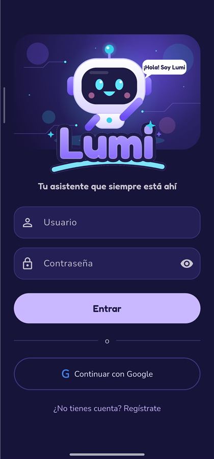

<div align="center">


### Tu asistente con inteligencia artificial que siempre está ahí 💜

Responde tus dudas · Te da ideas · Analiza tus fotos · Te recuerda cuidarte

<br>

<a href="https://github.com/A1ex9915/lumi/releases/latest/download/lumi.apk">
  
</a>

<br><br>


</div>

<br>

<table>
  <tr>
    <td width="38%" align="center">
      
    </td>
    <td>
      <h3>👋 ¡Hola! Soy Lumi</h3>
      <p>Un robotito amable que vive en tu teléfono. Platica conmigo, mándame una foto y te digo qué veo,
      o pídeme ideas cuando no se te ocurra nada.</p>
      <ul>
        <li>✍️ Escribo mis respuestas <b>palabra por palabra</b>, en vivo</li>
        <li>📸 Entiendo tus <b>fotos</b> de la cámara o la galería</li>
        <li>❤️ Reacciono cuando te gusta lo que digo</li>
        <li>☁️ Guardo tus chats en la nube, aunque cambies de teléfono</li>
        <li>🌙 Modo oscuro y diseño para vertical u horizontal</li>
      </ul>
    </td>
  </tr>
</table>

---

## 📲 Instalar en tu teléfono

| 1️⃣ Descarga | 2️⃣ Instala | 3️⃣ ¡Listo! |
|:---:|:---:|:---:|
| Toca el botón morado **Descargar para Android** de arriba | Abre `lumi.apk` y permite **"Instalar apps de fuentes desconocidas"** | Entra con **Continuar con Google** o regístrate con tu correo y verifícalo |

> 💡 ¿Ya tienes Lumi? Instala la nueva versión encima: **no pierdes tus chats**.
> Todas las versiones están en [**Releases**](https://github.com/A1ex9915/lumi/releases).

---

## 💬 Comentarios de testers

¿Ya probaste Lumi? **Tu opinión nos ayuda a mejorarla.** Elige qué quieres contarnos:

<div align="center">

[](https://github.com/A1ex9915/lumi/issues/new?template=1-error.yml)
[](https://github.com/A1ex9915/lumi/issues/new?template=2-idea.yml)
[](https://github.com/A1ex9915/lumi/issues/new?template=3-opinion.yml)

**Así vamos** · se actualiza solo

[](https://github.com/A1ex9915/lumi/issues?q=is%3Aopen+label%3Abug)
[](https://github.com/A1ex9915/lumi/issues?q=is%3Aopen+label%3Aenhancement)
[](https://github.com/A1ex9915/lumi/issues?q=label%3Afeedback)
[](https://github.com/A1ex9915/lumi/issues?q=is%3Aclosed)

👉 [**Ver todos los comentarios**](https://github.com/A1ex9915/lumi/issues) y dale 👍 a los que también te pasen

</div>

> Para comentar aquí necesitas una cuenta de GitHub (es gratis). También puedes opinar desde la app:
> menú ☰ → **Comentarios de testers**.

---

## ✨ Lo que Lumi hace por ti

<table>
  <tr>
    <td align="center" width="25%"><br><b>Responde tus dudas</b></td>
    <td align="center" width="25%"><br><b>Te da ideas</b></td>
    <td align="center" width="25%"><br><b>Aprende contigo</b></td>
    <td align="center" width="25%"><br><b>Te recuerda cuidarte</b></td>
  </tr>
</table>

| | Función |
|:---:|---|
| 🤖 | Chat con IA (Gemini) que escribe en vivo, con botones para **detener** y **pedir otra respuesta** |
| 📸 | Envía fotos y Lumi te explica qué ve |
| ❤️ | Reacciones, **respuestas rápidas** ("Más simple", "Dame un ejemplo"…) y expresiones animadas |
| ☁️ | Historial de conversaciones en la nube, visible también sin conexión |
| 🔐 | Inicio de sesión con **Google** o **registro con correo**: se verifica el correo con un enlace y la contraseña debe tener 8+ caracteres y un carácter especial |
| 💬 | **Comentarios de testers** dentro de la app, con estrellas, capturas y 👍 en tiempo real |
| 👩‍💼 | Panel de administración: crear usuarios, cambiar roles y bloquear cuentas |

### Las caras de Lumi

<div align="center">


</div>

---

## 🧑‍💻 Para desarrolladores

<details>
<summary><b>🏗️ Arquitectura</b></summary>

<br>

Lumi **no necesita servidor propio**: la app habla directo con Firebase.

| Pieza | Servicio |
|---|---|
| Inicio de sesión | Firebase Authentication (Google y usuario/contraseña) |
| Usuarios, conversaciones, fotos y comentarios | Cloud Firestore |
| Respuestas de la IA (streaming y fotos) | Firebase AI Logic → Gemini |
| Seguridad | [`firestore.rules`](firestore.rules): cada quien solo ve sus chats |

```
lib/
├── main.dart              Arranque y cambio login/chat
├── config.dart            Modelo de Gemini, personalidad de Lumi, administradores
├── theme.dart             Colores, fuentes e imágenes de la marca
├── api_service.dart       Firebase Auth + Firestore + Gemini y estado de la sesión
├── models.dart
└── screens/
    ├── login_screen.dart      Login, registro con correo y Google
    ├── verify_email_screen.dart  Verificación del correo
    ├── chat_screen.dart       Chat, fotos, reacciones, historial
    ├── feedback_screen.dart   Comentarios de testers
    └── users_screen.dart      Administración de usuarios
assets/lumi/               Logo, ícono e ilustraciones de Lumi
firestore.rules            Reglas de seguridad de Firestore
.github/ISSUE_TEMPLATE/    Formularios de comentarios de testers
server/                    Backend antiguo (Express + SQLite), ya no se usa
docs/                      Documento de arquitectura y capturas
```

</details>

<details>
<summary><b>🛠️ Compilar desde el código</b></summary>

<br>

Requisitos: [Flutter](https://flutter.dev) y el [CLI de Firebase](https://firebase.google.com/docs/cli).

1. **Configuración de Firebase** (no está en el repositorio porque contiene la API key):
   ```bash
   firebase apps:sdkconfig ANDROID 1:349783982260:android:23c20d1560b7f4e988d7e1 \
     --project gen-lang-client-0815449786 --out android/app/google-services.json
   ```
   Si usas tu propio proyecto de Firebase, registra la app Android `com.example.chatbotmovil`,
   activa Authentication (Google y correo), Firestore y AI Logic (Gemini Developer API),
   y publica las reglas con `firebase deploy --only firestore:rules`.

2. **Ejecutar en un teléfono conectado:**
   ```bash
   flutter pub get
   flutter run
   ```

3. **APK de producción:** crea `android/key.properties` (no se sube a git) con tu llave de firma:
   ```properties
   storePassword=...
   keyPassword=...
   keyAlias=...
   storeFile=C:/ruta/a/tu-llave.jks
   ```
   y compila con `flutter build apk --release`. Sin `key.properties` se firma con la llave de depuración.
   Para que **Continuar con Google** funcione, registra en Firebase la huella SHA-1 de la llave con la que firmas.

</details>

<details>
<summary><b>👩‍💼 Administradores</b></summary>

<br>

Los correos de `ownerEmails` (en `lib/config.dart` y `firestore.rules`) se vuelven administradores al
entrar con Google por primera vez. Un administrador puede crear usuarios, cambiar nombre y rol, bloquear
cuentas y responder los comentarios de los testers.

</details>

<br>

<div align="center">

<br>
<sub>Hecho con 💜 por <a href="https://github.com/A1ex9915">A1ex9915</a></sub>
</div>
